# EasyNav

EasyNav is a custom Frappe app that adds one **global floating navigation button** to every Desk page. Every user builds their own menu of shortcuts from the button itself, so no code changes or administrator help are needed.

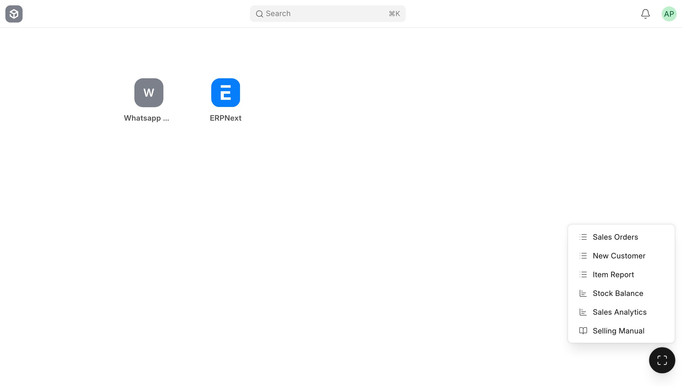

- Quick access to **DocTypes, Pages, Reports, Dashboards and external URLs**
- **Personal**: each user adds, edits and orders their own shortcuts, and nobody else sees them
- Site-wide options (enable/disable, button label, icon, position) are set in [**EasyNav Settings**](#easynav-settings)
- **Respects Frappe permissions**: users only see items they are allowed to open

## Contents

- [How it fits together](#how-it-fits-together)
- [Getting started: build your menu](#getting-started-build-your-menu)
- [Every user has their own menu](#every-user-has-their-own-menu)
- [Using the menu](#using-the-menu)
- [Navigation items](#navigation-items)
- [EasyNav Settings](#easynav-settings)
- [Support access for System Managers](#support-access-for-system-managers)
- [Permissions](#permissions)
- [Troubleshooting](#troubleshooting)
- [Upgrading from the shared menu](#upgrading-from-the-shared-menu)

## How it fits together

EasyNav adds three DocTypes to the **EasyNav** module:

| DocType | What it holds | Who uses it |
|---|---|---|
| **EasyNav Settings** | One record for the site: enable switch, button label, icon and position | System Managers |
| **EasyNav User Navigation** | One record per user: that user's shortcuts, shown to them as **My Shortcuts** | Every Desk user, for their own record; System Managers for anyone's |
| **EasyNav Item** | One row in a user's shortcut table (child table, not opened on its own) | Edited inside My Shortcuts |

When a user loads Desk, EasyNav combines the site settings with that user's enabled items, drops any item the user is not allowed to open, and draws the button and menu.

## Getting started: build your menu

This walkthrough follows Asha, a sales user with the *Sales User* and *Stock User* roles, as she sets up her menu for the first time. Any Desk user can do the same; no administrator is involved.

### 1. Find the button

The floating button sits in a corner of every Desk page (bottom right by default). A new user has no shortcuts yet, so clicking the button shows a short hint instead of a menu:

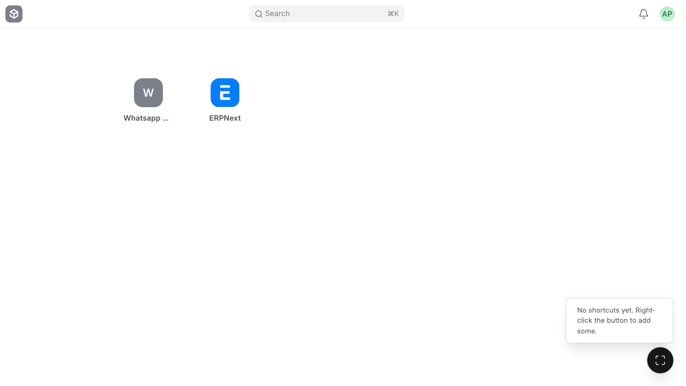

The button's icon, label and corner are chosen by a System Manager in [EasyNav Settings](#easynav-settings). This site uses the `maximize` icon; the default is `menu`.

### 2. Open your shortcuts

**Right-click the button.** On a touch screen, press and hold it instead; on a keyboard, focus it and press the context-menu key. There is no separate edit button. Hovering the button shows a tooltip as a reminder (*EasyNav · Right-click to edit your shortcuts*).

The first time, EasyNav creates your list and opens it. The page is titled **My Shortcuts**:

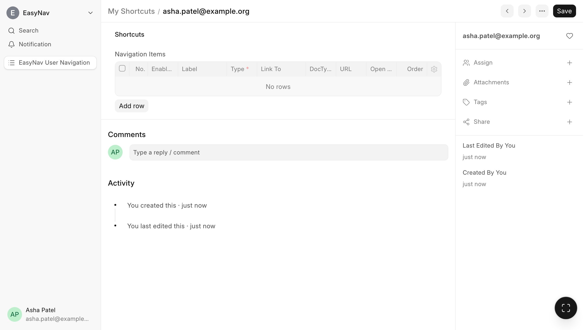

### 3. Add a shortcut

Click **Add row**, then the pencil icon at the end of the row to edit it in full. Enter a **Label**, choose a **Type** and pick what it opens in **Link To**.

The Link To suggestions only list records you are allowed to open. Here Asha types `sales` and is offered the sales DocTypes her roles can read:

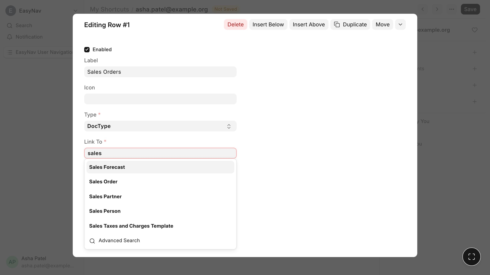

### 4. Choose how it opens

The fields below Type change with the type you choose. A **DocType** item gets a **DocType View** (List, Report Builder, New, Kanban and so on); leave it blank for the default view.

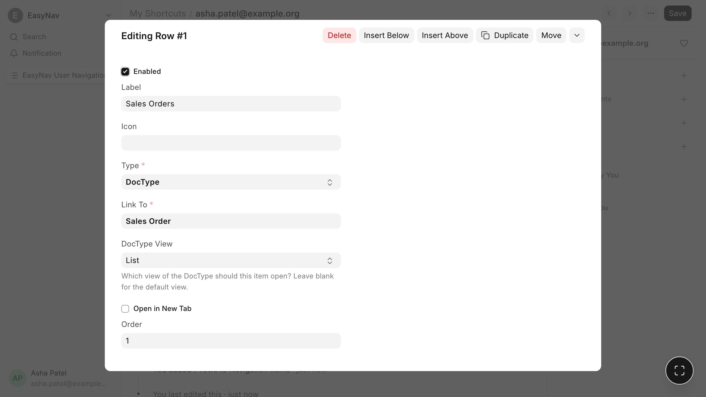

A **URL** item gets a URL field instead. It can be an external `https://` address or a path on this site starting with `/`. Asha's link to the ERPNext selling manual uses its own icon and opens in a new tab:

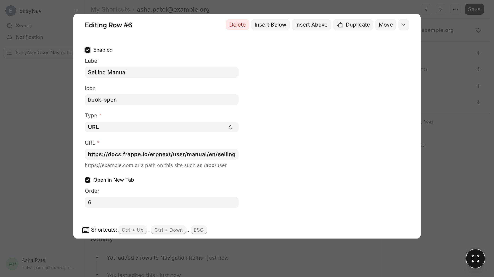

All the fields are described under [Navigation items](#navigation-items).

### 5. Save

Add the rest of your shortcuts and click **Save**. Set **Order** to control the sequence (lower first). Untick **Enabled** to keep a row as a draft: it is saved but not shown in the menu, and it may be left incomplete. Asha's *Delivery Trips (draft)* row below has no target yet.

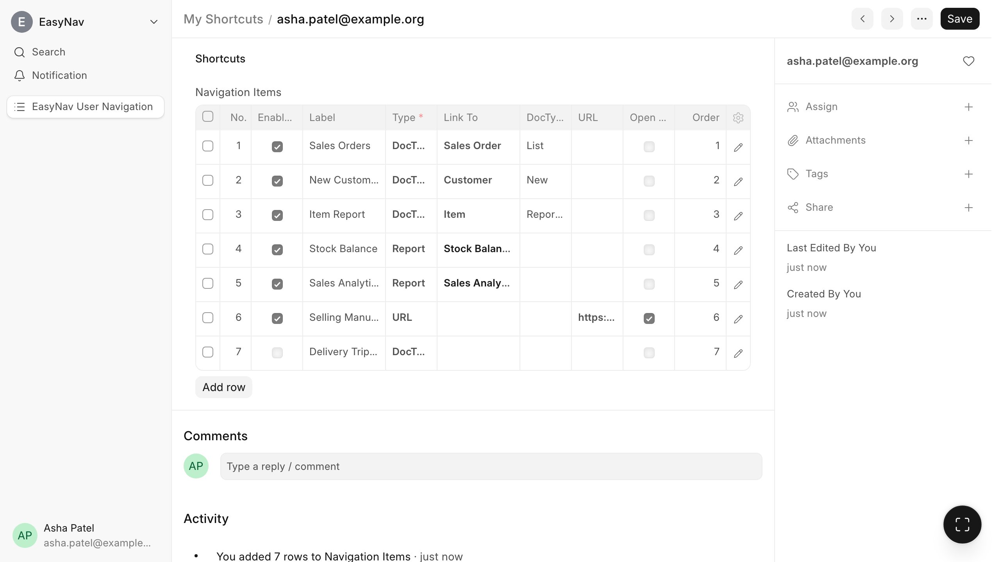

The menu updates as soon as you save; there is no need to reload.

### 6. Use your menu

Click the button. Asha's menu now lists her six enabled shortcuts in order, each with an icon for its type (the draft is left out):

| Asha's item | Type | Opens |
|---|---|---|
| Sales Orders | DocType, view List | Sales Order list |
| New Customer | DocType, view New | A new Customer form |
| Item Report | DocType, view Report Builder | Item in Report Builder |
| Stock Balance | Report | The Stock Balance report |
| Sales Analytics | Report | The Sales Analytics report |
| Selling Manual | URL, new tab | The ERPNext selling manual |

To change your shortcuts later, right-click the button again.

## Every user has their own menu

Each user's shortcuts are stored in their own **EasyNav User Navigation** record. Ravi, an accountant with the *Accounts User* role, built his own list in the same way. On the same site, his button opens a completely different menu:

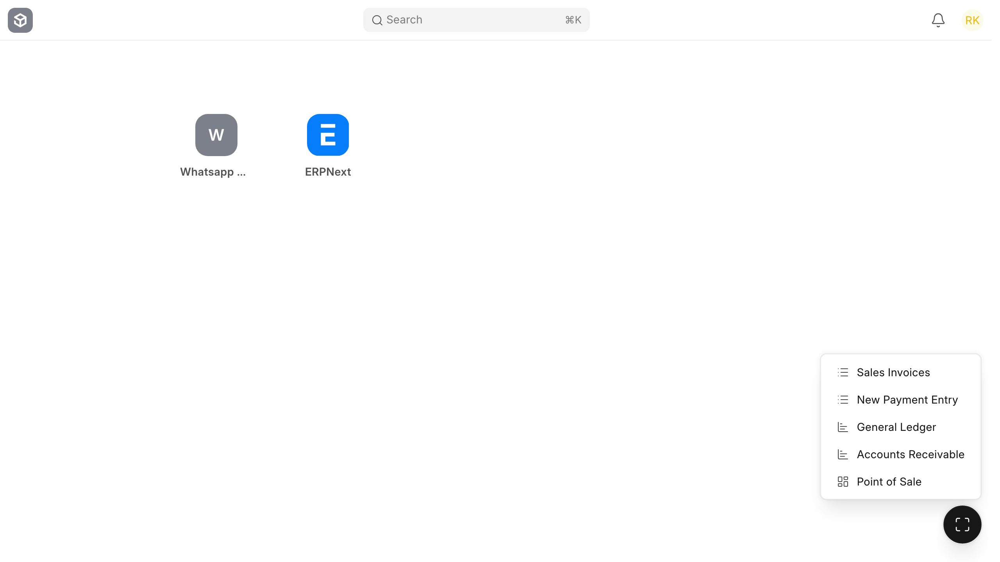

Neither user can see the other's list. If Ravi opens the **EasyNav User Navigation** list (`/desk/easynav-user-navigation`), the only row is his own:

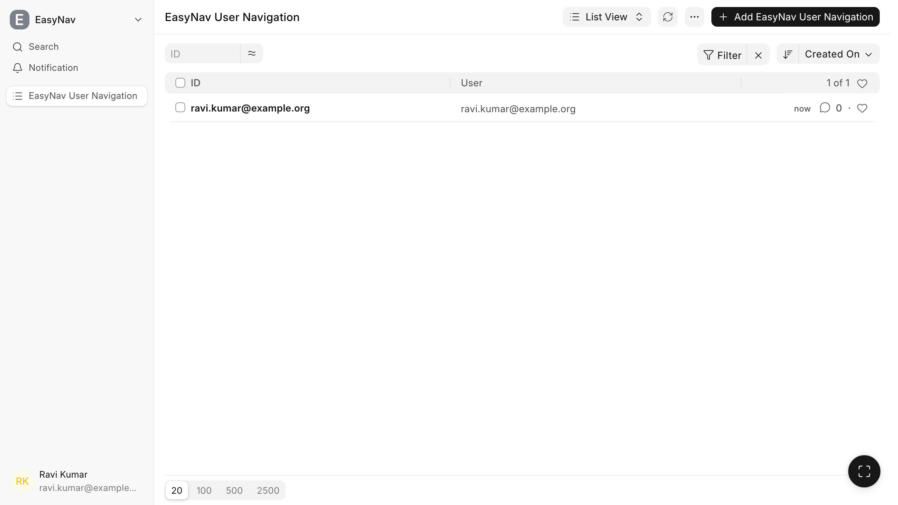

For an ordinary user, **Add EasyNav User Navigation** simply opens their own list, since each user has exactly one.

## Using the menu

| Action | Result |
|---|---|
| Click the button | Opens the menu and keeps it open |
| Click the button again, click outside, or press `Esc` | Closes the menu |
| Hover the button (mouse only) | Opens the menu; it closes when the pointer leaves |
| `ArrowDown` / `ArrowUp` | Moves through the menu items |
| Click an item | Opens it, in the same tab or a new tab as configured |
| Ctrl/Cmd-click or middle-click an item | Opens it in a new browser tab |
| Right-click the button (press and hold on touch screens) | Opens **My Shortcuts**, your own list |

The menu closes automatically when you move to another Desk page. The button is not shown on printed pages, and it sits behind open dialogs.

The button is hidden only when EasyNav is disabled in the settings. A user with no shortcuts still sees it, so there is always a way to add some.

## Navigation items

Each row of **My Shortcuts** is one menu item. A list can hold up to **30** items.

| Field | Notes |
|---|---|
| Enabled | Disabled rows are never shown and may be left incomplete, so you can keep drafts |
| Label | Text shown in the menu |
| Icon | Optional icon name from Frappe's icon set (letters, digits, `_`, `-`), e.g. `book-open`. Blank uses the default for the type |
| Type | `DocType`, `Page`, `Report`, `Dashboard` or `URL` |
| Link To | Shown for `DocType`, `Page`, `Report` and `Dashboard`: pick the record of that type to open. Only records you are allowed to open are suggested |
| DocType View | Shown for `DocType` only: `List`, `Report Builder`, `Dashboard`, `Tree`, `New`, `Calendar`, `Kanban` or `Image`. Blank opens the default view |
| Kanban Board | Shown when DocType View is `Kanban`: optional board to open |
| URL | Shown for `URL` only: the address to open |
| Open in New Tab | Opens in a new browser tab |
| Order | Lower first. Items with no order (blank or `0`) follow in row order |

Changing an item's Type clears the values that belonged to the old type (Link To, URL, DocType View and Kanban Board).

Where each type takes the user, and the icon it gets when Icon is blank:

| Type | Opens | Default icon |
|---|---|---|
| DocType | The chosen DocType View (the list view when blank), or the form for Single DocTypes | list |
| Page | The Desk page | layout-dashboard |
| Report | The report view (Query/Script reports and Report Builder reports) | chart-bar |
| Dashboard | The dashboard view | layout-dashboard |
| URL | The URL, either an external site or a path on this site | external-link |

### Validation

A list is checked on save. If something is wrong, nothing is saved and the error names the row with the problem. Here a URL row using `javascript:` is rejected:

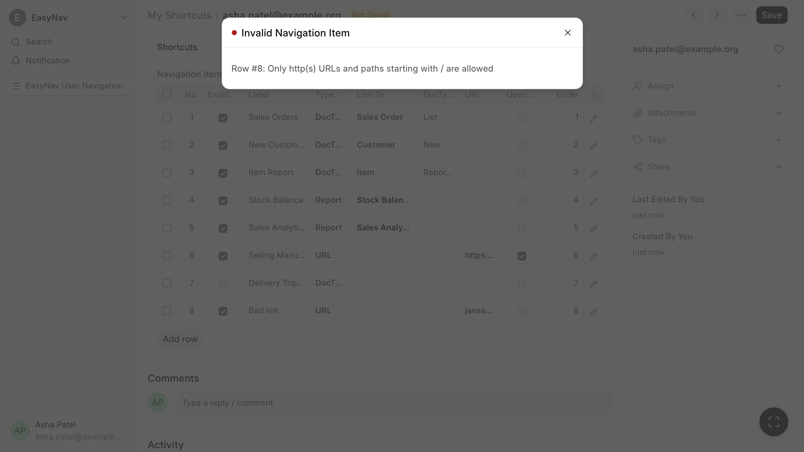

The checks are:

- Enabled rows need a label, plus a Link To (or a URL for `URL` rows).
- The DocType, Page, Report or Dashboard in Link To must exist. Child-table DocTypes are rejected.
- The Tree view needs a tree DocType, and a Kanban Board must belong to the selected DocType.
- URLs must be `http(s)://...` or a path starting with a single `/`.
- Icon names must be a plain name; Order cannot be negative.
- A list can hold at most 30 items.

If a target is deleted or renamed after the list was saved, that item is left out of the menu and the rest keep working.

## EasyNav Settings

**EasyNav Settings** is a Single DocType: one record for the whole site, at `/desk/easynav-settings`. Only System Managers can open it. It controls the floating button that every user sees. The shortcuts themselves are not here; each user keeps their own in [My Shortcuts](#getting-started-build-your-menu).

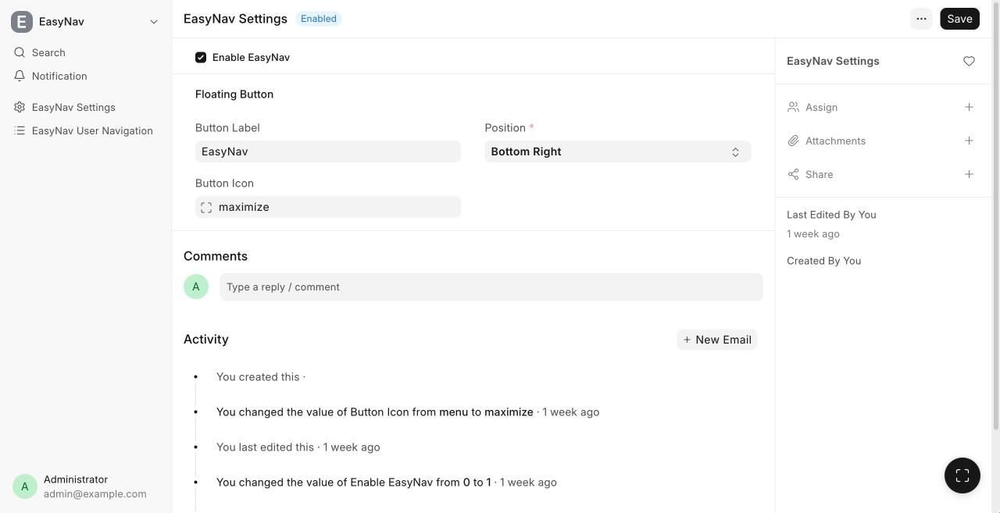

| Field | Type | Default | What it does |
|---|---|---|---|
| Enable EasyNav | Check | On | Shows or hides the floating button for every user, System Managers included. Turning it off keeps everyone's shortcuts; they come back when it is turned on again |
| Button Label | Data | `EasyNav` | The button's tooltip (*EasyNav · Right-click to edit your shortcuts*) and its accessible name for screen readers. Blank falls back to `EasyNav` |
| Button Icon | Icon | `menu` | The icon drawn on the button, chosen from Frappe's icon picker. An unknown icon name falls back to `menu` |
| Position | Select | Bottom Right | The corner of the screen the button sits in: Bottom Right, Bottom Left, Top Right or Top Left |

### Choosing the button icon

Click **Button Icon** to open the icon picker, then search by name or pick from the grid. This site uses `maximize`, which is why the screenshots in this guide show a frame icon instead of the default menu icon.

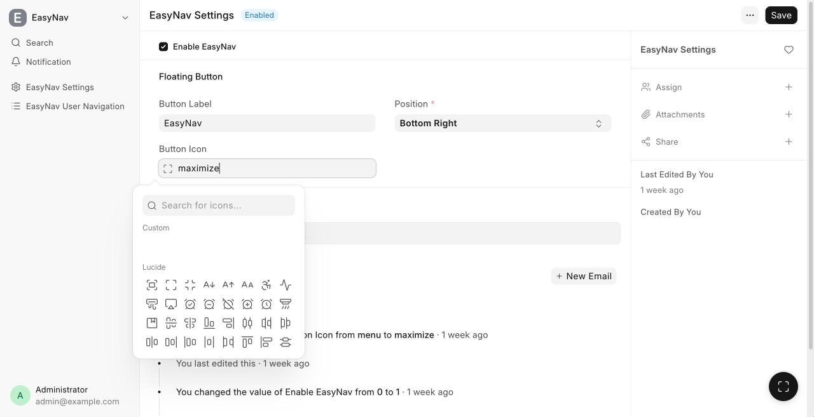

### When changes take effect

After **Save**, the button updates straight away for the System Manager who saved. Other users see the change the next time they load or reload Desk.

### What moved out of the settings

In 1.x, EasyNav Settings also had a **Navigation Items** table holding one menu for everyone. That table is gone:

- Each user's shortcuts live in their own **EasyNav User Navigation** record. See [Every user has their own menu](#every-user-has-their-own-menu).
- System Managers who need to look at or fix someone's shortcuts use [support access](#support-access-for-system-managers), not the settings.
- The old shared items are deleted on upgrade. See [Upgrading from the shared menu](#upgrading-from-the-shared-menu).

## Support access for System Managers

System Managers can open **EasyNav User Navigation** (`/desk/easynav-user-navigation`) to see every user's list, for example to help someone set up their menu or remove a broken item.

- **View or change a list**: open the user's row. A blue note at the top of the form reads *You are editing the shortcuts of &lt;user&gt;* so it is clear the list is not your own. Your own list is still titled **My Shortcuts**.
- **Create a list for a user**: click **Add**, pick the **User** and fill in the items. Each user has at most one list.
- **Delete a list**: only System Managers can delete one. The user starts again with an empty menu.

Edits to someone else's list are recorded in the document history. The user sees them the next time they load Desk. Items they are not allowed to open stay hidden from them, whoever added them.

## Permissions

EasyNav is not a permission system. It only hides menu items the current user cannot open, and Frappe still enforces access at the destination.

| Type | Shown to a user when |
|---|---|
| DocType | They have read permission on the DocType (create permission for the `New` view, report permission for `Report Builder`) |
| Page | Their roles are allowed to open the Page |
| Report | Their roles are allowed to open the Report and they have report permission on its DocType |
| Dashboard | They have read permission on the Dashboard |
| URL | Always |

- Only System Managers can view or change EasyNav Settings.
- A user can only read and change their own shortcuts. They can create one list, for themselves, and cannot delete it.
- System Managers can view, add, change and delete any user's list, and those edits are recorded in the document history.
- A user's list is deleted when the user is deleted, and follows the user when they are renamed.
- If someone else adds an item to your list that you are not allowed to open, it is not shown to you.
- Guests never see the button.
- Links using `javascript:`, `data:` and similar schemes are blocked.

## Troubleshooting

| Problem | Cause and fix |
|---|---|
| I can't see the button | EasyNav is disabled in EasyNav Settings, you are not logged in, or you are on a print view |
| The menu says *No shortcuts yet* | Your list is empty, or none of its items are enabled. Right-click the button to add some |
| An item I saved is missing from the menu | The row is not Enabled, you lack permission to open its target, or the target was deleted or renamed |
| *Could not find Row #n: Link To: …* on save | The Link To value does not exist on this site. Pick it from the suggestions instead of typing it |
| Changes made by a System Manager don't show | Reload Desk; they appear the next time you load it |

## Upgrading from the shared menu

Earlier versions had one menu for everyone, configured in EasyNav Settings. That shared list is **not carried over**: `bench migrate` deletes it, and every user starts with an empty menu. Note down the old items before upgrading if users will want to re-create them. See [RELEASE_NOTES.md](RELEASE_NOTES.md) for everything that changed in 2.0.0.

## License

mit
